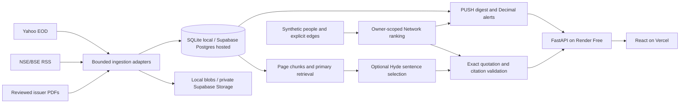

# FINN · investor intelligence with evidence

FINN connects portfolio events, primary-source company research, and the people who could help an investor understand them. Built for the **ENAM Founding AI Engineer Build Challenge** using React, TypeScript, Tailwind, FastAPI, and SQLAlchemy.

**Status:** functional local prototype; Vercel + Render Free + Supabase deployment configuration is prepared. Hosted URLs are not yet provisioned or verified. The public source repository contains no downloaded reports, investor database, or inference credentials.

## What works

| Layer | Implemented workflow | Boundaries |
|---|---|---|
| PUSH | Date-window portfolio digest, deterministic categories/materiality, routine collapse, exact filing excerpts, original citations, contextual people | RSS is a short window, not a comprehensive archive. Reasons to investigate are review prompts, not forecasts. |
| PUSH alerts | Saved price thresholds with direction; volume versus prior 5–60 observations; category rules; persisted trigger receipts and pause controls | Completed EOD data and periodic RSS only; in-app delivery. No real-time feed, SMS, or email. |
| PULL | Arbitrary supported NSE ticker; annual reports/transcripts/results; page-preserving parsing/chunks; ranked primary-only retrieval; optional Hyde evidence selection; verified PDF-page citations | Discovery is a reviewed catalog. Missing documents produce an explicit evidence gap. Guidance-to-actual linkage is not yet automated. |
| NETWORK | Synthetic professional histories, education, expertise, direct/second-degree paths, company/person matching, explainable relevance ranking inside events and research | All people and connections are explicitly synthetic. No LinkedIn scraping, private-profile import, inferred acquaintance, or outreach. |
| Product | Mobile navigation, portfolio search, research lenses, alert settings, evidence/profile drawers, loading/error/empty/stale states | Browser layout automation was blocked; user-supplied desktop screenshots were inspected. Mobile behavior has component tests, not a completed visual audit. |

### Actual local data, verified 16 November 2026

- **18 listed companies, 15 sectors; 1,872 EOD price/volume observations.** Yahoo chart endpoint, not exchange-certified market data.
- **32 parsed primary documents:** TCS 3, Reliance 21, Pidilite 8. This includes exchange letters, not 32 independent financial reports.
- **22 imported announcements:** Reliance 18, Pidilite 4. Date labels span 1 April 2025–13 November 2026; coverage between those dates is not exhaustive.
- **10 explicitly synthetic people** with career/education fixtures and explicit relationship edges.

Counts describe the verified local workspace; a fresh clone has only synthetic fixtures until real ingestion or migration runs. Exact document URLs are in [the reviewed catalog](backend/app/fixtures/primary_sources.json); actual outcomes are in [verification records](docs/verification). See [data sources](docs/DATA_SOURCES.md) and the [PDF requirement trace](docs/REQUIREMENTS_TRACE.md).

## Run locally

Requires Python 3.12 and Node 22.12+.

```sh
python3 -m venv backend/.venv
backend/.venv/bin/pip install -r backend/requirements-lock.txt
cd backend
.venv/bin/python -m uvicorn app.main:app --reload --loop asyncio --host 127.0.0.1 --port 8001
```

In a second terminal:

```sh
cd frontend
npm ci
npm run dev
```

Open http://127.0.0.1:5173. API documentation: http://127.0.0.1:8001/docs.

No `.env` file is required: the backend reads process environment variables directly. Start it from the terminal where the Hyde variables are exported. Optional examples: [backend](.env.example), [frontend](frontend/.env.example). Never put an inference key, database password, or storage credential in a `VITE_` variable.

### Populate real data

Run from `backend` with the same database/storage settings as the API:

```sh
.venv/bin/python -m app.ingest refresh --portfolio --dataset prices
.venv/bin/python -m app.ingest refresh --portfolio --dataset filings
.venv/bin/python -m app.ingest refresh --ticker TCS --ticker RELIANCE --ticker PIDILITIND --dataset documents
.venv/bin/python -m app.ingest refresh --ticker RELIANCE --ticker PIDILITIND --dataset filings --mode replay
```

Price windows support `--start YYYY-MM-DD --end YYYY-MM-DD`; the end is exclusive. Today's incomplete candle is excluded. Replay imports only genuinely retrieved dated disclosures. Live views never silently substitute historical records. An empty result means no stored observations in that scope, not proof nothing happened.

The API can poll sources automatically (five minutes locally, fifteen minutes in the free-host configuration) and evaluate saved rules every minute while running. Manual refresh shares an in-flight job and respects source cooldowns. Free Render sleeps while inactive; this is not an always-on alert service.

### Where data lives

| Data | Local | Hosted configuration |
|---|---|---|
| Companies, prices, events, PDF page text, chunks, graph, rules, research/cache | `backend/finn.db` (SQLite WAL) | Supabase Postgres |
| Downloaded source bytes, SHA-256 addressed | `backend/data/blobs/` | Private Supabase Storage bucket `finn-private` |
| Reviewed URLs and synthetic fixtures | Source JSON/Python | Source repository |
| Keys/passwords | Process environment; optional ignored `.env` | Render secret environment settings |

Hosted database and source files do **not** live on Render's temporary disk. Local SQLite remains supported. [Deployment guide](docs/DEPLOYMENT.md) includes a one-time data-copy tool, restart verification, and the exact account actions needed.

## Architecture



SQLite uses FTS5/BM25; Postgres uses built-in English full-text search with a GIN index. Both preserve company/document/page boundaries. Models, data providers, raw file storage, retrieval, and API services are independent modules. The graph is relational with bounded two-degree traversal. See [architecture and API boundaries](docs/ARCHITECTURE.md).

## AI, calculations, and cost

**LLM:** only on-demand PULL evidence selection and ordering. Hyde's OpenAI-compatible adapter defaults to disabled without credentials. The locally verified model is `hyde/glm-5.3-flash` at `https://inference.hyde.tech/v1`. It selects sentence IDs; code reconstructs exact quotations and validates each citation. This is deliberately conservative extractive research, not unrestricted generated analysis. Uncited model limitation prose is replaced with a controlled evidence-gap message.

**Deterministic code:** ingestion, company matching, classification/materiality, filing excerpts, graph ranking, alert rules, PDF parsing, retrieval, numerical extraction, and comparisons. Decimal calculates changes and volume ratios. Conflicting latest-period values are withheld; unsupported tables are not guessed.

Caches: prices 6 hours, RSS 5 minutes, PDFs 7 days, research 6 hours keyed by owner/question/document hashes/model/pipeline. SHA-addressed files deduplicate storage. HTTP revalidation, source throttles, Retry-After, negative caching, bounded downloads, and one active research request reduce redundant work. Reviewer mode limits research to 20 requests/hour for the shared workspace; model calls have a 45-second timeout and bounded output. In-process budgets reset with the API; set a provider-side spend limit too. Hosting free tiers do **not** make inference free.

## Verify

```sh
cd backend
.venv/bin/python -m pytest -q
.venv/bin/python scripts/check_startup.py
```

```sh
cd frontend
npm test
npm run build
```

```sh
python3 scripts/check_release.py
python3 scripts/package_source.py
```

The backend suite covers unsupported tickers, missing reports, inaccessible sources, HTTP cooldowns, deduplication, empty digests, no relevant connections, owner isolation, exact citations, conflicting evidence, Decimal comparisons, invalid thresholds, failed LLM requests, private storage transport, and public-demo access boundaries. Postgres integration additionally runs when `FINN_TEST_POSTGRES_URL` names a **disposable database `finn_audit`**; it drops that test schema and verifies migration, persistence, sequences, and retrieval. Never point tests at production.

[Audit findings](docs/AUDIT.md) distinguish fixes from remaining limits. [The live smoke verifier](backend/scripts/verify_deployment.py) checks frontend delivery, API responses, CORS, event-to-person integration, and optionally a real research request. Local verification is recorded separately from hosted verification; no deployed check is claimed yet.

## Five-minute demo

1. Open **Briefing → Historical replay**. Inspect an event's original filing/page, its factual excerpt, review prompt, and relevant synthetic connection.
2. Select **Custom** with a broad window. Inspect per-company coverage; expand routine disclosures. Check that historical dates remain labeled.
3. Open **Portfolio**, search a ticker, and inspect stored EOD prices and their source dates.
4. In **Alerts**, create a 3% Reliance price rule. Evaluate 2 November 2026 in historical mode using the local verification dataset; inspect the triggering value and baseline, then pause the rule. A fresh 120-day download may have a different available window.
5. Open **Research → PIDILITIND**, choose snapshot, and ask about business segments and operating performance. Inspect every page citation and “Who can help?” context. Try `UNSUPPORTED` to see the evidence-gap behavior.
6. Try trajectory/guidance lenses. Discuss the comparable evidence and explicitly unsupported promise-to-outcome linkage rather than presenting an invented verdict.

## Security and remaining work

The default local server is loopback-only. Hosted `public_demo` mode opens the synthetic workspace without a login or access code, as requested for evaluation. Legacy `reviewer` mode settings migrate to `public_demo`; old reviewer token/frontend flags are ignored and can be removed from dashboards. Visitors share demo rules and outputs, so do not import real private investor/contact data. Request budgets and single-request research concurrency remain; CORS is not authentication. Raw PDFs and full page export remain disabled remotely, and operator ingestion requires its separate private token. Supabase database/storage keys remain backend-only. See [security/privacy decisions](docs/SECURITY.md).

Remaining work includes comprehensive licensed filings, wider numeric-layout support/OCR, real consent/import/deletion workflows, durable queues, schema migration history/backups, production monitoring, and authenticated per-investor workspaces. No proprietary PDFs/database are published in GitHub. Public source access does not imply redistribution rights.

Deployment steps: [Vercel + Render Free + Supabase](docs/DEPLOYMENT.md). Final artifacts and blockers: [submission checklist](docs/SUBMISSION_CHECKLIST.md). Repository: https://github.com/err400/Finn.
