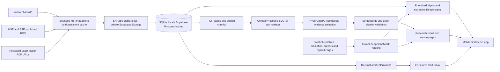

# Architecture and privacy decisions

Providers implement independent market/filing/document contracts; the model adapter
is separate from retrieval and grounding validation. HTTP caching, source
normalization and file storage are shared infrastructure. SQLAlchemy isolates SQL
dialect details. The first prototype uses local SQLite and content-addressed
files rather than a vector service, graph database, queue or cloud dependencies.
SQLite FTS5/BM25 and Postgres English full-text search provide inspectable retrieval without embedding API cost; a GIN index supports the hosted path. Relational
edges plus a bounded breadth-first search are enough for two-degree reach.

Canonical financial entities are `ingestion_snapshots`, `ingestion_cache`,
`ingestion_identifiers`, `ingestion_eod_prices`, `ingestion_documents`,
`ingestion_document_pages`, `ingestion_filings`, `ingestion_filing_origins`,
and `ingestion_runs`. Financial documents have immutable source hashes; content
corrections create new captures. Filing origins preserve each exchange/provider,
raw publication value and retrieval mode. Exact document content/company/local
publication day deduplicates cross-source copies; metadata-only entries can be
merged when their attachment later becomes available. Distinct content is not
merged by a fuzzy headline match.

Research chunks never cross a PDF page. Citations point at the **1-based PDF page**,
which may differ from printed page numbering. Answer cache keys include owner,
ticker, question, workflow, document hashes, model identity and pipeline version;
failed model responses are not cached. Network recommendations are refreshed
outside the answer cache. Financial table extraction and arithmetic never depend
on the model. Invalid citations invalidate the answer instead of being shown.

The API evaluates stored-data rules every 60 seconds. Source polling is now coordinated in the local API every five minutes; manual
refresh requests share the same job and a persisted five-minute cooldown. The
foreground CLI watcher remains optional. EOD source refreshes reuse six-hour
windows; failed sources have a retry cooldown instead of being retried for every
holding. No agent
plans tools or acts independently; there is no outreach or trading capability.
No model is used for bulk source ingestion, classification, graph matching or
numeric alerts. Hyde receives the research question and public primary-source
passages only; contact records and relationship edges are not sent.

## Current privacy boundary

This is a **local personal-use synthetic demo**, not authenticated multi-tenancy.
The fixed owner is `synthetic-demo`. Contact, edge, rule, alert and research-cache
queries scope that owner; graph traversal rejects edges into another owner's
contacts. Profiles with `synthetic=false` are excluded by the demo network service.
No endpoint imports real contacts. All biographies, education, professional roles,
strength values and personal relationships are invented and labeled. Sector-peer
mappings are demo relevance mappings, not assertions about commercial relationships.
The model never invents a real management biography or infers friendship from
co-employment. Exact normalized person aliases can return ambiguous results.

Local mode requires loopback access. Hosted public demo mode intentionally opens the synthetic workspace without a login. It retains an exact Origin allowlist, request budgets, and one active research request. Raw PDF downloads remain disabled remotely. This is a shared synthetic reviewer workspace, not production user authentication. CORS is not authorization. Uvicorn's deployed command disables forwarded-header trust. Secrets stay server-side; no frontend access code is required.

The hosted configuration uses Supabase Postgres and a private Supabase Storage bucket independently of Render's temporary disk. SQLite and filesystem adapters remain the local defaults. Postgres initialization creates the search GIN index, enables RLS, and revokes browser-role grants. The operator-only copier moves an existing local workspace into an empty cloud database and uploads SHA-verified blobs. It does not erase a populated destination. Render Free may sleep; database/object data persists outside that compute lifecycle. Supabase Free may pause after inactivity and is not a backup guarantee.

Only synthetic names, experience, education, aliases, demo last-contact dates,
explicit edges and ordinal strengths are stored. No phone numbers, email,
private notes, actual acquaintance lists or LinkedIn credentials are seeded.
The prototype retains this local demo data until reset; it implements no promise
of timed personal-data deletion. To reset, stop API/watchers, remove the local
SQLite database and `backend/data`, then restart. This removes local research,
alerts, fixtures and captures together; do not do this to a live investor workspace.

## Before production or broader public distribution

- Obtain appropriate market-data/content rights; public availability is not a
  redistribution license. Choose licensed APIs where needed.
- Resolve the owner from verified authentication, authorize every object access,
  and add independent cross-tenant tests/database policies. Never accept owner
  identity as a client-supplied query parameter.
- Support explicit import consent, profile provenance, correction and withdrawal.
  Distinguish a person's public profile permission from the investor's right to
  store a private relationship.
- Encrypt transport, database/object storage and backups; separate service and
  user privileges; redact logs and audit reads/writes without storing secrets.
- Set a documented retention policy (for example, configurable 90-day inactive
  profile review and short operational-log retention), then actually implement
  scheduled expiry. Offer person/contact deletion, export and investor-account
  deletion, including derived matches, caches, edges and backup expiry.
- Use a model service with appropriate data-processing terms. Keep network data
  out of external inference by default, and require explicit consent if a future
  feature needs it. Configure spend limits, request limits and safe error handling.
- Add migrations, managed backups, source-job leases, observable freshness,
  alert-delivery retries and secured hosting. Local file locking is intentionally
  a single-host design, not a distributed queue.
